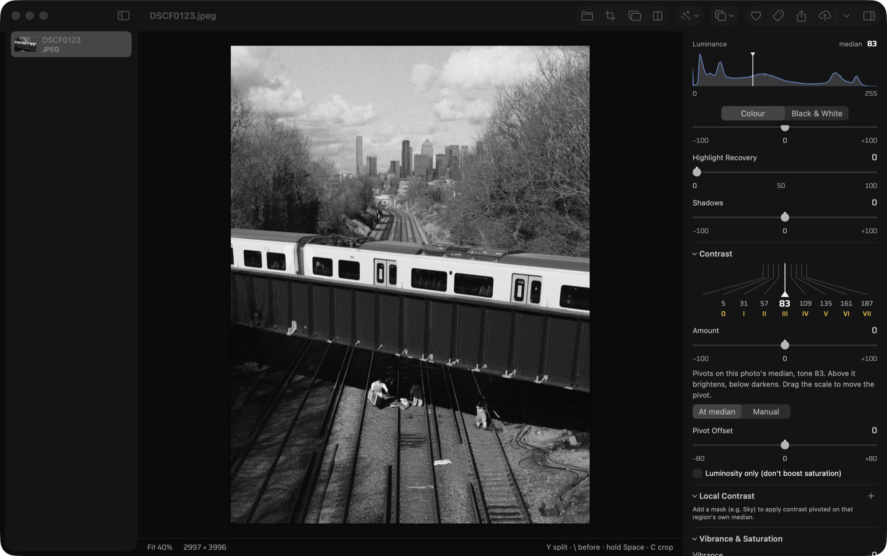

# Fulcrum

An opinionated photo editor for macOS. Fulcrum takes a shoot from the card to finished, uploaded photos in one lean app, and it is built around one way of editing rather than every option.



## The idea

Global contrast, masked local contrast and B&W tone all **pivot on the photo's measured median**. That keeps the curve locked where the photo's tones actually sit. Above the pivot brightens and below it darkens, and you can drag the scale to move the pivot. The app is named after this pivot.

## What it does

- **Import:** connect a camera or card. Each RAW+JPEG pair counts as one shot. Flag shots keep or reject, then import.
- **Edit:** light, contrast, colour mixer and grading, black & white, local masks and detail, all in a native inspector.
- **Local masks:** Sky and Subject (both automatic), Linear Gradient, Luminance Range and Whole Image. Each mask re-measures its own median on every photo.
- **Reuse:** copy and paste settings between photos, or save a **Look**. A Look holds every setting except the crop.
- **Deliver:** export, or upload to Apple Photos (with keywords and favourites) or to Google Photos through your own OAuth client.
- **Reflect:** every edit is appended to a JSON-lines log. The Style Patterns window summarises your habits across photos.

Fulcrum supports camera RAW, JPEG, HEIC/HEIF, PNG and TIFF, and it never writes to your original files.

## Keyboard

| Key | Action |
| --- | --- |
| `C` | Crop |
| `Y` | Split before/after |
| `\` or hold `Space` | Before |
| `⌘⇧C` / `⌘⇧V` | Copy / paste settings |
| `⌘E` | Export |
| `⌘U` | Upload |
| `⌘⇧I` | Import from camera |
| `⌘⌥P` | Style Patterns |

## Build

You need macOS 14 or later and a Swift 5.9+ toolchain (Xcode 15+).

```bash
./scripts/build-app.sh
open build/Fulcrum.app
```

The script builds a release binary, generates the app icon and signs the bundle with your `Apple Development` identity. To sign ad hoc instead, set `FULCRUM_SIGN_IDENTITY=-`.

`fulcrum-check` is a test harness for the engine. It checks pipeline behaviour on synthesised images:

```bash
swift run fulcrum-check
```

## Project layout

| Path | Contents |
| --- | --- |
| `Sources/FulcrumCore` | The Core Image pipeline: tone, colour grading, B&W, masks, vignette, rendering |
| `Sources/Fulcrum` | The SwiftUI/AppKit app |
| `Sources/fulcrum-check` | Engine test harness |
| `scripts/` | App bundle build and icon generation |
| `PRODUCT.md`, `DESIGN.md` | Product intent and design system |
| `docs/` | Design notes |

## Licence

The bundled Saira font is under the SIL Open Font Licence (see `Resources/Fonts/OFL.txt`).
